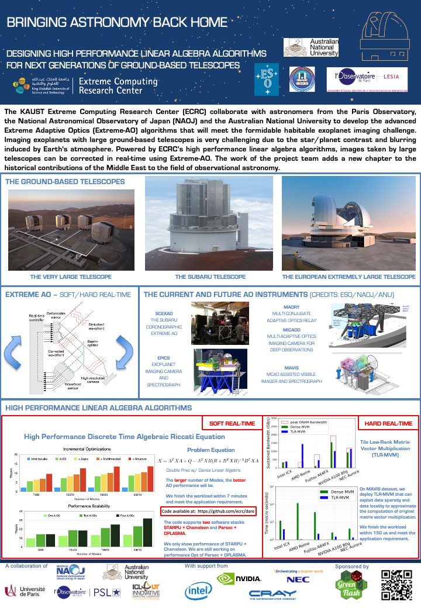

# DARE Solver

## DARE → ATA → AO 闭环验证（7,090 / 12,570 / 28,210）

本流程使用 Jesse 的 `jcranney/ata`、`DARE_opt` 分支
（本次 checkout：`5cbad07e83fceadc86e093ec6ee65e918a22ba16`）。
脚本在 [benchmark/ao](benchmark/ao/)。DARE 求解与控制器组装均为 FP64；
本次闭环 MVM 明确使用 FP32，与 ATA 的默认实时状态向量精度一致。
这不是混合精度 DARE，也没有使用 TLR。

**两个问题要分别测量：**

1. 更新控制器需要多久：计时 DARE、输入、布局转换、输出，以及整个进程耗时。
2. 控制器是否改善成像：把输出装回 ATA/COMPASS，测残余波前 RMS、
   短曝光/长曝光 Strehl、视场内各目标的表现、命令稳定性和限幅。

`Time:` 包括 Riccati 迭代和最终增益求解，不包括文件读写。
`Wall seconds:` 包括该求解进程的初始化和 I/O，但不包括排队、传文件、
ATA 控制器组装或光学仿真。仿真的运行速度也不是实时控制器的 MVM 延迟。

### 输入与矩阵方向

原始数据的三个规模是 **7,090、12,570、28,210**，对应 10 层大气的
圆形网格分辨率 **31、41、61**。它们具有相同的 18,694 个观测量；
重建光学配置有 5,294 个 DM 执行器和 10 个评估目标。
不要把 12,870 或 21,820 当作这些文件的真实维度。

用 Astropy 读取原始 FITS 时，`At.fits` 是估计模型的 A，形状 n×n；
`Btinitial.fits` 是观测矩阵 C₁，形状 m×n；DARE 输出 `result-K.fits`
读出来的形状是 n×m，它对应 **Kalman 增益 L₀**。
它不是 ATA 最终施加给 DM 的控制矩阵 K。求解器内部采用转置后的 LQR 约定，
不能根据文件名再盲目转置一次。P 是误差协方差，用于数值验证。

在本次单速率 R=1、交叉噪声协方差为零的模型中，ATA 的组装关系是：

```text
A_c   = A - L₀ C₁
A_rtc = Pf A_c
L_rtc = Pf L₀ C_filter
G_rtc = Pf L₀ C₂
K_rtc = -tilde_K hack_proj[1]
```

其中 Pf 逐层去除 piston，C_filter 去除 LGS tip/tilt，C₂ 将 DM 命令映射到
WFS 斜率，tilde_K 是 ATA 的 MCAO 投影。仅凭 P/K 文件无法恢复所有这些量；
还需要生成原始模型时的标定、光瞳、DM/WFS 坐标、大气层和投影参数。

脚本调用原始 `step_3.py` 的 FP64 协方差和 `kMCAO` 函数，并明确保留
旧数据生成器的 5×5 方形投影方向（±15 arcsec）及风速约定。
`prepare_model.py` 逐个 WFS 检查首末大气层的 A/C₁ 子块，输出
`model-check.json`。它不会忽略弱 NGS 子块，也不会用拟合变换偷偷修改数据。

**当前限制：** 已有标定 pickle 重建的 LGS 子块可以接近原始输入，
但 NGS 子块存在明显不匹配。标记为 `reconstructed-model-mismatch` 的
闭环结果只能用于这套重建配置下的诊断和硬件输出对照，不能作为原始
MAVIS 系统绝对性能已经复现的证明。严格复现还需要原始 NGS 标定/模型来源；
也可以另建一套完全匹配的仿真模型和 DARE 输入，但必须与原始数据实验分开。

### 软件环境和闭环延迟

需要 COMPASS 5.5、NumPy/SciPy、Astropy、PyCUDA、scikit-cuda 和 CuPy。
本工作区的环境入口是 `../log/ao-size-sweep/runtime.sh`，Python 解释器由
其中的 `$compass_py` 给出。将临时目录和 CUDA 编译缓存放到工作盘。

旋转 WFS 光瞳需要更大的大气屏幕边界。本次在独立的 COMPASS Python
副本中应用 [边界补丁](benchmark/ao/compass-atmos-rotation-padding.patch)，
没有覆盖原始 checkout。复现时应记录该补丁、COMPASS 版本、参数文件和 ATA
版本；漏掉边界补丁可能触发 CUDA 非法地址，得到的结果不能使用。

本流程调用原始 `ATASupervisor.loopLQG` / `nextLQG`，其递推为：

```text
x = A_rtc x + L_rtc s - G_rtc um1
um1 = u
u = K_rtc x
```

原始函数还显式保留旧斜率和旧命令。使用这一接口时，脚本把 COMPASS
额外控制器延迟设为 **0**。保留旧 `generic_linear` 配置中的额外一帧延迟
会重复计算延迟，本次 7k 负对照因此发散。不要把不同闭环时序的结果混在一起。
命令发散时，即使浮点数暂时仍然有限，Strehl 也可能产生虚假的高值；脚本
设置命令幅值中止阈值并保存 `failure.json`。默认阈值 100 是诊断保护值，
不是项目给定的 DM 行程规格。

`--backend cpu` 使用原始 NumPy 递推；`--backend gpu` 只替换这四次
dense MVM 的执行位置，保留 `nextLQG` 的光学传播、测量和延迟顺序。
所有机器的 DARE 输出在同一仿真环境中评估，避免把仿真版本差异当作硬件差异。

### 从求解到测量的命令

以下路径相对于本仓库的父目录，即含 `dare/`、`ata/`、`datasets/` 的工作区。

1. 检查输入文件维度、精度和 SHA-256；在两个集群上使用同一份原始输入。
   Perlmutter 的入口是 [solve_perlmutter.sh](benchmark/ao/solve_perlmutter.sh)；
   DAI 使用 [build_dai.sh](benchmark/ao/build_dai.sh) 构建隔离的 ARM 版本，
   再提交 [solve_dai.sh](benchmark/ao/solve_dai.sh)。两者都用四张 GPU、FP64 LU，
   保存 P、K、日志和二进制校验值。DAI 另外比较 nb=720/1440 和异步范数。
   集群路径、账户和分区在脚本内显式列出，迁移时需要调整。
2. 取回每种尺寸的 `result-P.fits`、`result-K.fits`、`solver.log`，
   先做数值检查，再组装控制器。以下示例对应 Perlmutter 作业 61125702：

```bash
source log/ao-size-sweep/runtime.sh
N=7090
RES=31
INPUT=datasets/$N
MODEL=log/ao-size-sweep/$N/model
SOL=log/ao-size-sweep/perlmutter/61125702/$N

"$compass_py" dare/benchmark/ao/check_residual.py \
  --inputs "$INPUT" --solution "$SOL"

"$compass_py" dare/benchmark/ao/prepare_model.py \
  --ata ata --params datasets/ata-yuxi-tlr/params_mavis_large.pkl \
  --inputs "$INPUT" --states "$N" --resolution "$RES" --out "$MODEL"

"$compass_py" dare/benchmark/ao/build_controller.py \
  --inputs "$INPUT" --model "$MODEL" --gain "$SOL/result-K.fits" \
  --out "$SOL/controller" --rtc-dtype float32
```

`check_residual.py` 使用固定的 16 个随机向量检查投影 Riccati 残差，
按块读取文件以限制内存。它不是完整矩阵残差，也不能替代闭环测试。
跨硬件还应使用 `benchmark/pmt/compare-fits.py` 逐块比较完整 P/K，保存相对
Frobenius 误差和最大绝对误差；FP64 并行实现不要求逐字节相同。

3. 相同配置、相同种子分别测量各个输出。每次 1,000 帧，前 200 帧预热，
   在预热结束时清空长曝光累积，使用 1100、2300、3700 三个大气种子。
   本配置每帧模拟时间为 1 ms，因此一次只代表 1 s 的短时仿真。

```bash
for SEED in 1100 2300 3700; do
  "$compass_py" dare/benchmark/ao/run_native.py \
    --ata ata --params dare/benchmark/ao/mavis_archive.py \
    --controller "$SOL/controller" --out "$SOL/ao-$SEED" \
    --frames 1000 --burn-in 200 --seed "$SEED" --backend gpu \
    --allow-model-mismatch
done
```

`--allow-model-mismatch` 是本次重建原始模型的诊断选项。若需要严格匹配的
验证，应先解决 `model-check.json` 中的差异，然后去掉该选项。
使用同一命令加 `--open-loop` 得到零 DM 命令的对照；开环光学配置对三种
状态尺寸相同，不需要重复三遍。正式使用 GPU MVM 前，先用相同 seed
与 `--backend cpu` 做一次轨迹/指标对照；再重复同一基准检查可重复性。

12k 使用 N=12570、RES=41；28k 使用 N=28210、RES=61。
28k 原始文件带数字后缀，可在独立输入目录创建 `At.fits` 等符号链接，
不要覆盖数据。DAI 输出使用相应作业目录，其他模型和测量参数保持一致。

### 应读哪些结果

每次闭环保存 `strehl.npy`（frames×targets×4）和 `metrics.json`。
四列分别是短曝光 Strehl、长曝光 Strehl、瞬时相位方差、累积相位方差。
波前 RMS 由相位方差转换：

```text
WFE_rms_nm = sqrt(mean(phase_variance_rad2 * (lambda_nm / (2*pi))**2))
```

比较视场平均和轴上长曝光 Strehl（越高越好）、视场波前 RMS（越低越好）、
各目标结果、最大命令和限幅帧数。跨随机种子报告均值和离散程度；
先看每个种子相对于同种子基准的配对差值，不把目标/时间帧当独立样本。
1000 帧三种子只是初步测试；它不验证三分钟更新周期、大气参数漂移、
长期稳定性或真实实时系统的延迟/抖动预算。

### 本次实测结果与状态（2026-11-11）

Perlmutter 作业 **61125702** 已完成：4×A100，FP64 LU，nb=720，ib=180。
下表时间是原始 FITS 路径的单次启动测量；AO 列是三个种子的均值。
**AO 列均受上述 NGS 标定不匹配限制，只作诊断。**

| 状态数 | DARE 求解 s | 进程总耗时 s（含 FITS I/O） | 短曝光 Strehl | 长曝光 Strehl | 波前 RMS nm |
|---:|---:|---:|---:|---:|---:|
| 7,090 | 4.173 | 25.10 | 27.30% | 6.47% | 630.9 |
| 12,570 | 13.433 | 36.24 | 33.38% | 7.96% | 630.6 |
| 28,210 | 124.951 | 193.57 | 35.82% | 8.57% | 630.2 |
| 开环（相同光学配置） | — | — | 0.38% | 0.076% | 1181.1 |

三个规模的长曝光 Strehl 跨种子样本标准差分别为 **2.95、3.87、4.19 个百分点**；
波前 RMS 的标准差约 **178–179 nm**。这些不是均值的置信区间。
规模增加时 Strehl 提高，但本次总波前 RMS 几乎不变；在修复 NGS 模型差异前，
不要据此判定真实系统的最佳规模或性能上限。
三个规模的 16 向量投影 Riccati 残差分别为
`7.56e-13`、`8.56e-13`、`8.51e-13`。

同种子 GPU 重复测试的 300 帧序列逐元素完全一致。CPU/GPU 单步命令相对差异
`9.02e-7`，各自对 FP64 参考的误差均小于 `1e-6`；300 帧闭环中 CPU/GPU
平均长曝光 Strehl 相差约 **0.055 个百分点**，波前 RMS 相差 **0.034 nm**。
这说明后端的 FP32 舍入仍会影响非线性闭环，跨硬件对照应统一评价后端。

另两组 28,210 原生 tile 输入实验已完成 ABCCBA 对照和完整 P/K 校验：

| 实验 | 基线均值 s | 候选均值 s | 结论 |
|---|---:|---:|---|
| 异步收敛范数 | 118.052 | 117.354 | 约快 0.6% |
| 异步范数 + 独立更新缓冲 | 118.052 | 117.932 | 基本无收益 |
| 静态 TRSM | 118.188 | 119.408 | 约慢 1.0% |
| 静态 TRSM + LU | 118.188 | 119.430 | 约慢 1.0% |

这些候选的完整 P/K 相对 Frobenius 误差均小于 `1e-10`。
静态 TRSM/LU 的 GPU 间传输量约减少 9%，但没有缩短求解时间。
上述选项仍为默认关闭；FITS 路径与原生 tile 路径的总耗时不可直接混用。

### 28,210 原生 tile 并行 I/O 复测（61127596）

2026-11-11，Perlmutter nid008652，4×A100 SXM4 80GB；FP64 LU、NB=720、IB=180，
5 CPU workers、每 GPU 2 个 CUDA workers；五个输入文件并行、每文件 2 个读线程，
P/K 同时写出、每文件 4 个写线程。原始文件已预先打包为原生 tile 格式；本次不计预打包时间。
采用既有静态 GEMM 放置，异步范数与静态 TRSM/LU 关闭。仅增加 steady_clock 检查点，没有增加 GPU 同步。

| 进程阶段（秒） | 第一次启动 | 同节点第二次启动 |
|---|---:|---:|
| Chameleon / StarPU 初始化 | 7.268 | 1.928 |
| 并行 tile 输入 | 17.025 | 16.934 |
| FP64 求解（含最终 K） | 120.860 | 118.720 |
| 并行 tile 输出 P/K | 11.651 | 9.700 |
| 描述符 / 工作区释放 | 13.590 | 8.994 |
| 运行时 finalize | 2.171 | 2.065 |
| 其他，包括 main 外启动/退出 | 2.025 | 1.399 |
| **进程总时间** | **174.59** | **159.74** |

两次均值：求解 **119.790 s**，输入+输出 **27.655 s**，其他 **19.720 s**，总计 **167.165 s**。
两次均为 17 轮。完整 P/K 比较全部通过：相对历史参考 61077914，P 最大差 `6.141e-11`，K 最大差 `9.575e-12`（脚本门槛 `1e-9`）。
未清空文件系统缓存，不能称为真正的 cold-disk 基准。
输入约 23.966 GB，P/K 输出约 10.585 GB；输入含主机 tile 分配/注册，输出含 StarPU 主机获取、
必要的 GPU→CPU 传输、pwrite/close，**未调用 fsync**，不能把这些计时等同于纯存储设备吞吐。
进程墙钟不含队列、Slurm step 启动、数值检查、上游模型更新、后续 RTC 矩阵组装或控制器部署。

旧 FITS 作业 61125702 的输入为 20.477 s、输出为 31.684 s、总计 193.57 s；
本次 tile I/O 合计为 26.634–28.676 s，明显低于旧 FITS 的 52.161 s。
这是不同作业/缓存状态的历史对照，不是严格同节点的 I/O-only A/B 加速比。
旧优化 tile 记录 157.44 s 也保留为历史结果，不能替代本次实测。
初始化与清理带来的波动已单独计时；长期驻留进程和缓冲区复用值得下一步测量，收益尚未验证。

复现入口：`benchmark/pmt/instrument-wall.py`、`run-io-breakdown.sh`、
`summarize-io-breakdown.py`、`plot-io-breakdown.py`。
原始源码副本、构建脚本及结果：工作区 `../log/pmt/cusolver-lu/28210-io-breakdown/`；
结果目录 `results/61127596/` 包含 `run-1.log`、`run-2.log`、`hardware.txt`、
`provenance.sha256`、`accuracy.jsonl`、`timings.csv/json` 和 `time-breakdown.png/pdf`。

**DAI 新测量尚未完成：** 已提交 4×GH200 作业 **3576001**，7k/12k 输入已逐文件
通过 SHA-256 校验，28k 使用已有验证数据。编译的求解器源文件与 Perlmutter
异步范数分支一致，分别使用 ARM/OpenBLAS 和 x86/MKL 构建。
截至本次状态记录，DAI 作业仍因 Priority 排队，不能报告新的 GH200 时间或 AO 数值。
[finish_dai.sh](benchmark/ao/finish_dai.sh) 在作业完成后取回数据、检查残差、完整比较
P/K，并用相同配置和种子运行 ATA；失败会写 `POSTPROCESS_FAILED`，全部成功才写
`POSTPROCESS_OK`。本工作区已启动该后处理等待进程。需要手动恢复时：

```bash
bash dare/benchmark/ao/finish_dai.sh 3576001
```

测量、原始逐帧序列和日志在工作区 `../log/ao-size-sweep/`。
用下面的命令重建汇总与可导出的图：

```bash
"$compass_py" dare/benchmark/ao/summarize.py log/ao-size-sweep
"$compass_py" dare/benchmark/ao/plot_results.py log/ao-size-sweep
```

主要产物为 `solver-timings.csv`、`ao-by-seed.csv`、`ao-summary.json` 和
`ao-comparison.png/pdf`。DAI 后处理结束会更新汇总；README 中的静态状态记录
应在查看新结果后更新，不代表一个永远实时刷新的状态页。

# 1. Introduction
This library provides a high-performance implementation of the Discrete time Algebraic Riccati Equation [(DARE)](https://en.wikipedia.org/wiki/Algebraic_Riccati_equation) solver. The DARE solver is used in Adaptive Optics (AO) system of extremely large ground-based telescopes with instruments such as MAVIS. It has significant better application's peformance than other traditional methods. However, the computational cost is also much higher. According to our benchmark on MAVIS specifications, the application has best accuracy when the matrix dimension is more than 20k x 20k. Our high-performance DARE solver exploits advanced linear algebra libraries associated with runtime system, such as [Chameleon](https://solverstack.gitlabpages.inria.fr/chameleon/) or [DPLASMA](https://github.com/icldisco/dplasma), to deploy the DARE algorithm onto shared-memory multicore systems equipped with multiple GPU hardware accelerators.

# 2. Dependencies
  * CMake (>=3.19)
  * CUDA (>=11.0)
  * Intel MKL (>=2018)
  * OpenMPI (>=4.0)
  * Chameleon or DPLASMA runtime system


# 3. Installation

We provide two [install scripts](https://zenodo.org/record/7309032) for user to download dependencies and compile
the dare solver library. 


# 4. Dataset
Input files available at:
https://kaust-my.sharepoint.com/:f:/g/personal/ltaiefh_kaust_edu_sa/EgaqEKCdWURBgDq3x2CNsXQBteQs4x0VIdiiHJcY8AVyVA?e=EzETNF


# 5. Running
The usage is provided by `./ddare --help`:
```Usage:
./ddare [options]

Options are:
  --help           Show this help

  --n=X            #samples x #layers. states    (default: 500)
  --ninstr=X       Instrument dimension. measurements (default: 500)
  --nb=X           tile size.            (default: 128)

  --datapath=X     path to the data folder
                   this folder must contain the following files:
                       At.fits
                       BinvRt.fits
                       Btinitial.fits
                       Rt.fits
                       Qt.fits
                   the parameters '--n' and '--ninstr' will be overwritten by the
                   corresponding dimensions of the files

  --threads=X      Number of CPU workers (default: _SC_NPROCESSORS_ONLN)
  --gpus=X         Number of GPU workers (default: 0)
  --sync           Synchronize the execution of all calls (default: async)
  --nooptalgo      Leverage matrix structure in the algorithm (default: optalgo)
  --profile        Profile the execution of all calls (default: no profile)
  --check          Check numerical correctness (default: no check)
  ```

The StarPU runtime also needs to be set up.
Example:
```
STARPU_SILENT=0 OMP_NUM_THREADS=1 MKL_NUM_THREADS=1 STARPU_CUDA_PIPELINE=4 STARPU_NWORKER_PER_CUDA=4 STARPU_SCHED=prio STARPU_CALIBRATE=1 ./ddare --threads=31 --n=7090 --ninstr=19078 --nb=320 --ib=80 --gpus=1
```
where `n` and `ninstr` are the dimensions of the problem. In this case, the matrices will be generated randomly
Or using input matrices (as fits files):
```
STARPU_SILENT=1 OMP_NUM_THREADS=8 MKL_NUM_THREADS=8 STARPU_CUDA_PIPELINE=2 STARPU_NWORKER_PER_CUDA=12 STARPU_SCHED=$j STARPU_CALIBRATE=1 ./ddare --threads=4 --nb=720 --ib=180 --gpus=1 --datapath=<path/to/data>
```
## Lair benchmark

The [benchmark utilities](benchmark/lair/) preserve the Lair build and Slurm runner. Copy them to a deployment directory with `downloads/starpu-1.3.11.tar.gz` and `downloads/chameleon-1.1.0.tar.gz`, then run `build-stack.sh` with the absolute path to the DARE source tree. The build script applies the CUDA 12 Chameleon patch. The benchmark build also used `dare-report-sequence-status.patch` to surface Chameleon task failures.

The Slurm runner takes the deployment directory, GPU type, and the GPU counts to benchmark. Allocate the largest requested count on one node and 12 CPUs per task with `--hint=nomultithread`. The runner uses the five size-7090 FITS files in `datasets/7090` under the deployment directory, with the names listed in [LINKS.md](LINKS.md). It writes one directory per job in `results/`.

In the development workspace, the Lair logs are stored beside this repository. Regenerate the CSV from the repository root with the following command.

```sh
python3 benchmark/lair/summarize.py ../log/lair
```

## Perlmutter benchmark

The [Perlmutter scripts](benchmark/pmt/) use CUDA 12.4, GNU 12, Cray MPI, and Intel MKL. Stage them in a private scratch directory with the two patches from `benchmark/lair/`, the DARE source in `src/dare/`, and the StarPU 1.3.11, Chameleon 1.1.0, and CFITSIO 4.0.0 archives in `downloads/`. The StarPU build also uses the upstream hwloc 2.10.0 headers `cuda.h`, `cudart.h`, and `nvml.h` in `compat/include/hwloc/`.

Run `build-stack.sh` on Perlmutter and pass the deployment directory to `benchmark-pmt.sh` in a single-node Slurm allocation with four A100s and 12 CPUs per task. An optional second argument selects the number of states and defaults to 7090. Put the corresponding FITS files in `datasets/<states>/` under the deployment directory using the filenames in [LINKS.md](LINKS.md). Use `python3 benchmark/lair/summarize.py ../log/pmt` to summarize the archived Perlmutter results.

## Perlmutter profiling and tuning

The optional [profiling runner](benchmark/pmt/profile-pmt.sh) writes separate results under `profiling/<job>/`. Copy it, `build-profile.sh`, and `dare-profile-copy.patch` into the deployment directory described above. Run `bash build-profile.sh` there to build an isolated `build/dare-profile/ddarechameleon`; the original executable remains available for comparisons. The source copy must already have the sequence-status patch applied by the standard build script.

The diagnostic executable retains FP64 arithmetic. `DARE_GPU_COPY=1` replaces full-matrix CPU-only `dlacpy` tasks with GPU-capable `dgeadd` tasks using coefficients 1 and 0. `DARE_PHASE_PROFILE=1` times stages with barriers; those timings describe synchronized stages and must not be mixed with ordinary asynchronous benchmarks. `DARE_STAGE_BARRIERS=1` enables the same stage boundaries without diagnostic timing. `DARE_OUTPUT_PREFIX` exports the final P and K matrices after solver timing ends.

Run the profiling script inside a one-node GPU allocation with the deployment directory and a whitespace-separated plan file as arguments. Each plan row contains `states label cpus workers tile streams scheduler mode repeats gpus variant`. The script comments describe the optional inner-block, task-window, export, and scheduler-weight fields. Every case has a separate warmup and StarPU model cache. Keep profiler runs separate from timing runs: StarPU 1.3.11's full profiling mode polls NVML energy counters for every GPU task and can severely perturb execution. Nsight defaults to the version bundled with HPC SDK 24.5; `DARE_NSYS` overrides its executable.

Use [summarize-tuning.py](benchmark/pmt/summarize-tuning.py) on a job's profiling directory to generate a CSV, including incomplete cases. A `run-N.exclude` file excludes a contaminated timing sample while preserving its log. [compare-fits.py](benchmark/pmt/compare-fits.py) compares exported FP64 matrices in chunks and reports relative Frobenius and maximum absolute differences. Its default comparison threshold is `1e-10`; report the actual errors and equation residuals when assessing numerical differences.

The selected experimental configuration uses GPU-capable copies, `dmda` with transfer-cost weight 4, and a submitted-task window of 5,000–10,000 tasks. It retains tile size 720, inner block 180, five CPU workers, and four CUDA workers per GPU. After sourcing the deployment's `env.sh`, run it as follows inside an allocation with four GPUs and at least 12 CPU cores:

```sh
export OMP_NUM_THREADS=1 MKL_NUM_THREADS=1
export STARPU_SCHED=dmda STARPU_SCHED_BETA=4
export STARPU_CUDA_PIPELINE=4 STARPU_NWORKER_PER_CUDA=4
export STARPU_LIMIT_MAX_SUBMITTED_TASKS=10000
export STARPU_LIMIT_MIN_SUBMITTED_TASKS=5000
DARE_GPU_COPY=1 build/dare-profile/ddarechameleon \
  --threads=5 --gpus=4 --nb=720 --ib=180 --datapath=datasets/28210
```

The source change remains opt-in pending an application-level numerical tolerance. In the 7,090-state check of the copy change alone, P differed from the reference by `4.93e-10` in relative Frobenius norm, exceeding the comparator's strict `1e-10` threshold; K differed by `5.63e-11`. The final equation residual divided by the reference P norm was approximately `8.40e-13` for the reference and `1.65e-12` with GPU-capable copies. A repeated reference run produced bitwise-identical P and K. With the full selected configuration at 28,210 states, both matrices passed the same comparison threshold: P differed by `8.70e-11` and K by `1.97e-11`. These checks do not measure closed-loop AO performance.

Profiling identified CPU-only full-matrix copies as a source of host round trips. At 12,570 states, the selected configuration reduced StarPU-reported CPU–GPU transfers from 138.96 GB to 41.10 GB and total transfers from 1,116.11 GB to 797.99 GB. CPU-only diagonal factorization tasks and convergence reductions remain. Full Nsight captures failed during import; a delayed five-second capture succeeded and confirmed FP64 GEMM kernels, but its wrapper returned before the warmup solve completed. That capture is only a short diagnostic sample. The first complete unprofiled run replaced the interrupted warmup, and an additional repeat preserved three measured samples for the large case. The runner now rejects a run with no completed solver timing.

Validation completed on 2026-11-07 using four A100 SXM4 80 GB GPUs and FP64 throughout. These are median solver times after warmup, excluding input loading, output export, and profiling:

| States | Measured runs per configuration | Baseline | Optimized | Time reduction |
| ---: | ---: | ---: | ---: | ---: |
| 12,570 | 2 | 28.3465 s | 18.463 s | 34.9% |
| 28,210 | 3 | 188.022 s | 144.861 s | 23.0% |

The smaller screening comparison used node `nid200336` throughout. The large baseline used the same node; its optimized validation used `nid008280`, with the same GPU model and configuration, after the original node became unavailable. Large optimized samples were 144.861, 144.546, and 145.636 seconds, all converging in 17 iterations. Optimized throughput was 43.57 TFLOP/s by the solver's operation count. These are four-GPU before/after improvements; the optimized one-GPU configuration has not been rebenchmarked. Workspace artifacts are in `../log/pmt/profiling/`: `performance-comparison.csv`, `performance-comparison.json`, `validation-protocol.json`, `large-accuracy.jsonl`, and per-job directories `60933653` and `60936725`. Regenerate the selected comparison with `python3 ../log/pmt/profiling/summarize-selected.py`.

The [UltraPlot figure generator](benchmark/pmt/plot-benchmarks.py) produces strong-scaling, time/speedup, and theoretical-peak comparisons from the archived measurements. Install [requirements-plot.txt](benchmark/pmt/requirements-plot.txt) in a virtual environment, then run `python benchmark/pmt/plot-benchmarks.py` from this repository. Outputs are saved to `../plots/pmt/` as vector PDF/SVG and 600-dpi PNG files, with a combined three-page PDF, source data, provenance, and captions. The optimized measurements are shown only at four GPUs; the generator does not infer an optimized scaling curve. The peak references are 9.7 TFLOP/s per A100 for standard FP64 and 19.5 TFLOP/s for FP64 Tensor Cores, using NVIDIA's published specifications.

## Optional cuSOLVER diagonal LU

The [Chameleon patch](benchmark/chameleon-cusolver-lu.patch) adds a CUDA StarPU codelet for FP64 no-pivot LU diagonal tiles. It reuses a cuSOLVER handle and workspace on each GPU and serializes `getrf` calls through completion on that GPU. Set `DARE_CUSOLVER_LU=1` with the patched runtime to enable it.

For an existing Lair or Perlmutter deployment, stage the [build script](benchmark/build-cusolver-lu.sh), the Chameleon patch, the [benchmark runner](benchmark/benchmark-cusolver-lu.sh), and `compare-fits.py` together under `cusolver-lu/`. Use the diagnostic executable from `build-profile.sh` to export the matrices. Run these commands from the deployment directory, with the benchmark command inside a single-node Slurm GPU allocation with at least 12 CPUs.

```sh
bash cusolver-lu/build-cusolver-lu.sh "$PWD"
bash cusolver-lu/benchmark-cusolver-lu.sh "$PWD" 7090 2
```

The build creates a separate StarPU library under `build/chameleon-cusolver/`. The runner loads it for both modes, alternates CPU and CUDA LU, checks the iteration and GPU tile counts, and compares the exported FP64 P and K matrices at a relative Frobenius tolerance of `1e-10`. It keeps three timed samples per mode and writes the logs under `cusolver-lu/results/<job>/`.

Pass `combined` as the fourth argument to compare the baseline, GPU copies with the tuned StarPU scheduler, GPU LU alone, and both optimizations together. This plan also tests the combined settings with two CUDA workers per GPU instead of four. It rotates the order of the measured runs and compares every candidate against the same CPU-LU reference.

Stage [the GPU norm patch](benchmark/chameleon-gpu-norm.patch) beside the LU patch to build the optional FP64 Frobenius tile norm. The CUDA codelet returns a scaled sum-of-squares pair for each tile. Chameleon still merges those pairs and checks convergence as before. Use `DARE_GPU_NORM=1` with the GPU norm overlay to enable it.

```sh
bash cusolver-lu/build-cusolver-lu.sh "$PWD" gpu-norm
bash cusolver-lu/benchmark-cusolver-lu.sh "$PWD" 12570 4 norm
```

The `norm` plan compares CPU and GPU tile norms with the same GPU copies, cuSOLVER LU, and two CUDA workers per GPU. It records StarPU transfer statistics during the two unmeasured warmups.

The diagnostic executable also accepts `DARE_SWAP_ALPHA=1` to exchange the two equal-sized descriptors after the final GEMM in each continuing iteration. This uses the GEMM output directly as the next `alpha` and saves a full matrix copy. To measure that change with the GPU norm enabled, build an isolated diagnostic binary with `bash build-profile.sh dare-profile-swap` and pass `swap` as the fourth argument to the benchmark runner.

## Perlmutter multi-node strong scaling

Build the diagnostic executable from the MPI-capable DARE source. It selects a near-square process grid from the MPI world size, distributes input tiles from rank 0, and collects the exported matrices on rank 0. Use one MPI rank with four GPUs per node. The `mpi` overlay disables Chameleon's derived MPI datatypes and uses StarPU's packed transfers. This configuration passed the distributed CUDA smoke test.

```sh
bash build-profile.sh dare-profile-mpi
bash cusolver-lu/build-cusolver-lu.sh "$PWD" mpi
export DARE_SCALE_BINARY="$PWD/build/dare-profile-mpi/ddarechameleon"
export DARE_SCALE_RUNTIME=chameleon-cusolver-mpi
bash scale-pmt.sh "$PWD" "$SLURM_JOB_NUM_NODES"
```

[The scaling runner](benchmark/pmt/scale-pmt.sh) defaults to 28,210 states. It records per-rank timings, GPU samples, and warmup-only StarPU bus and MPI send counters. The separate phase run inserts barriers to expose the cost of stages. The [summary script](benchmark/pmt/summarize-scale-pmt.py) uses the slowest rank for each completed solver run and keeps phase and transfer data separate from the timed median.

For a separate compression diagnostic, build [the MPI tile sampler](benchmark/pmt/sample-mpi-tiles.c) with the Cray MPI headers and set `DARE_SCALE_MPI_SAMPLE` to the shared object. The sampler writes up to 32 outgoing FP64 tiles per rank after the initial 16 GiB of sends. Analyze the samples with [analyze-tile-compression.py](benchmark/pmt/analyze-tile-compression.py). It measures adjacent-element variation, times LZ4 and Zstd on the host, and verifies bit-exact decompression. Keep the sampler out of performance measurements.

## Packed FP64 tile inputs

For a single MPI rank, `--tilepath` streams prepacked matrices into
Chameleon descriptors. Use the same tile size for export and solve.
The five input files are read concurrently. Set `DARE_TILE_READERS_PER_FILE`
to 1–4 to choose how many threads read disjoint ranges of each file.
The default is two. Each reader loads its range directly into StarPU's
tile buffers. `DARE_TILE_PINNED_INPUT=1` selects a contiguous pinned
allocation for comparison.
The archive converter verifies each FP64 word against the source FITS
before publishing the output directory.

```sh
python benchmark/pmt/pack-dare-tiles.py /data/28210 /data/28210-tiles720 \
    --states 28210 --measurements 18694
ddarechameleon --n=28210 --ninstr=18694 --nb=720 --ib=180 --gpus=4 \
    --tilepath=/data/28210-tiles720
```

Set `DARE_TILE_OUTPUT_DIR` to a new directory to export `K.tiles` and
`P.tiles` together. The solver streams both outputs from StarPU's host
tile buffers and publishes the directory once the files are complete.
Set `DARE_TILE_WRITERS_PER_FILE` to 1–4 to choose the number of writers
for each file. The default is two.

Upstream Python code can call `write_tiles(path, matrix, block=720)`
from [dare_tiles.py](python/dare_tiles.py) with a logical two-dimensional
FP64 array. A producer that generates individual tiles can call
`write_tile_blocks(path, rows, columns, tile_at, block=720)` with a
callback returning the requested tile. Publish a new directory once all
five files are ready.
For `n` states and `m` measurements, the expected files are
`At<n>.tiles` and `Qt<n>.tiles` of shape `n × n`,
`BinvRt<n>.tiles` and `Btinitial<n>.tiles` of shape `n × m`,
and `Rt<n>.tiles` of shape `m × m`.

Each file starts with the eight bytes `DARETIL1`, followed by three
little-endian 64-bit unsigned integers for the row count, column count
and tile size. The payload holds little-endian FP64 tiles in Chameleon's
packed order. The full tiles come first, followed by the bottom strip,
right strip and bottom-right tile. Each region enumerates tiles by tile
column and each tile stores its columns contiguously. Boundary tiles use
their actual dimensions. The Python exporter leaves all-zero FP64 tiles
as sparse file holes while preserving every input bit.

## Experimental FP64 solve placement

`benchmark/build-cusolver-lu.sh <deployment> gpu-static-solve` builds a
separate StarPU overlay that extends the existing four-GPU GEMM tile
placement to triangular solves and cuSOLVER LU. Enable `DARE_STATIC_GEMM=1`
and independently select `DARE_STATIC_TRSM=1` or `DARE_STATIC_LU=1`.
The new options default to disabled. TRSM follows its output tile's GPU
and LU follows its in-place factor tile's GPU, using the same 2-by-2
cyclic mapping as GEMM. Both CUDA workers on that GPU remain eligible.
Explicit application worker assignments take precedence.

This changes task placement while retaining FP64 kernels and the existing
dependencies. Constraining placement can reduce transfers but can also
limit load balancing, especially along the LU critical path. Treat it as
experimental until same-node 28,210-state timings and full P/K comparisons
show a benefit. It requires four CUDA devices and the static-GEMM patch.

## Experimental asynchronous convergence norm

`DARE_ASYNC_NORM=1` uses a persistent Frobenius-norm workspace and submits
the reduction immediately after forming `A_old^T * H`. The following
matrix update can be submitted before the host reads the norm. The host
acquires only the scalar result instead of draining all StarPU tasks and
flushing the source matrix. The same FP64 scaled-sum codelets, reduction
order, stopping quantity and tolerance are retained. This option defaults
to disabled and currently supports one MPI rank without `--check`.

The implementation targets the existing Chameleon 1.1 / StarPU stack.
Destroy its persistent workspace before finalizing Chameleon. CPU and GPU
checks in `dare/tests/convergence_norm.cpp` cover partial tiles, workspace
reuse, zero and extreme finite magnitudes, and acquisition of a ready norm
while an unrelated task is still running. Full-solver output comparisons
are also needed before accepting a new four-GPU configuration. Potential
overlap depends on the scheduler and available resources.

## Linear-system precision snapshots

Set `DARE_SNAPSHOT_DIR` to export the original FP64 system `S = I + G*H`
and its two matrix right-hand sides `A` and `G`, before LU overwrites `S`.
`DARE_SNAPSHOT_STEPS=1,8,16` selects doubling iterations. Each iteration
publishes an `it-<step>` directory containing `S.tiles`, `A.tiles`,
`G.tiles` and `manifest.json`. This single-rank diagnostic uses the packed
format above and `DARE_TILE_WRITERS_PER_FILE`. It adds synchronization,
host transfers and writes to the measured solver time. Leave it disabled
for performance measurements. At 28,210 states, three snapshots use
about 57.3 GB.

The independent CUDA replay compares no-pivot FP64 LU with no-pivot FP32
LU and FP64 residual refinement, reusing each factorization for both full
matrix right-hand sides:

```sh
nvcc -O3 -std=c++17 -arch=sm_80 benchmark/pmt/benchmark-linear-mixed.cu \
    -lcublas -lcusolver -Xcompiler -pthread -o benchmark-linear-mixed
./benchmark-linear-mixed /data/snapshots/it-8 0 3 > it-8-repeat-1.csv
python3 benchmark/pmt/summarize-linear-mixed.py /data/replay-results
```

The replay uses one GPU per process, FP32 TRSM with pedantic math, and
FP64 BLAS with default math. It reports every finite correction through
the requested limit, rather than stopping at a small backward error.
Timings exclude file reads, layout conversion, allocation and comparison
against the reference solution. Mixed-precision totals include residual
checks. The FP64 production-equivalent baseline excludes diagnostic
residual checks. These results measure isolated linear solves, not the
four-GPU DARE runtime or final AO performance.

Question
========

For more information and questions please send email to yuxi.hong@kaust.edu.sa and hatem.ltaief@kaust.edu.sa.

Handout
========

